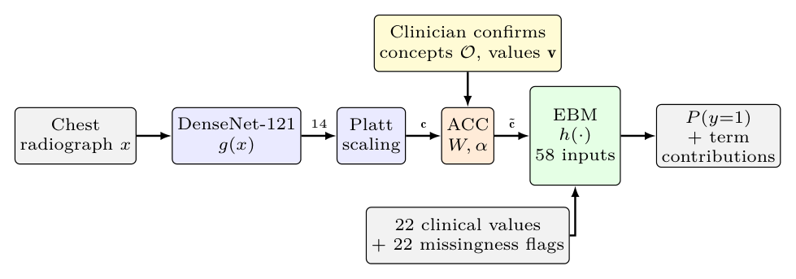
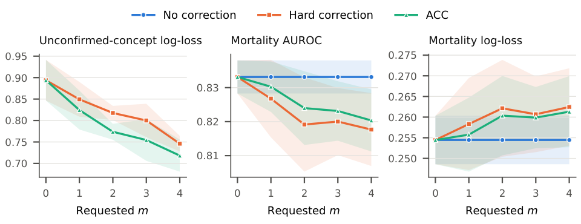
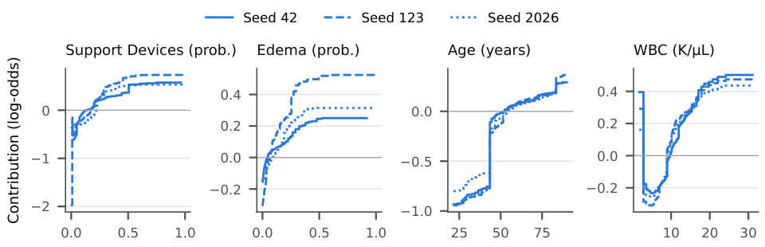

# ACC-ECBM: Interpretable In-Hospital Mortality Prediction from Chest Radiographs and Pre-Imaging Clinical Data with Concept Bottlenecks and Explainable Boosting

This repo is the official implementation of our paper:

**ACC-ECBM: Interpretable In-Hospital Mortality Prediction from Chest Radiographs and Pre-Imaging Clinical Data with
Concept Bottlenecks and Explainable Boosting**

Huy Nhat-Le, Khanh Quoc Tran-Duong

Faculty of Information Technology, Ton Duc Thang University, Ho Chi Minh City, Vietnam

*In preparation for Springer LNCS.* [Paper: coming soon]

## Overview of ACC-ECBM

<p align="center">

</p>

Chest radiographs are acquired early in many admissions, but models that combine them with clinical data to predict
mortality rarely show which radiological findings drive a prediction, or let a clinician correct them. ACC-ECBM
predicts in-hospital mortality at the first chest radiograph of an admission and accepts corrections of the predicted
findings:

- **Concept predictor.** A DenseNet-121 (ImageNet initialization, fully fine-tuned) predicts 14 report-derived
  CheXpert findings. Training probabilities are produced out of fold and calibrated with Platt scaling.
- **Adaptive concept calibration (ACC).** When a clinician confirms the concepts `O` with values `v`, the confirmed
  concepts are locked and the others are moved through a fixed correlation matrix of training labels:
  `c_j ← clip(c_j + α · Σ_{i∈O} W_ij (v_i − c_i), 0, 1)`. Without confirmations ACC is the identity.
- **Explainable boosting machine (EBM).** An EBM combines the 14 concepts with 22 clinical values recorded before the
  image (age, an age-topcoding flag, sex, 12 blood laboratory values, 7 emergency-department triage values) and their
  22 missingness flags, 58 inputs in total. Every prediction decomposes into additive, inspectable term contributions.

The study answers four pre-specified questions on the same patients, splits and seeds:
**RQ1** do image concepts add value over clinical data alone; **RQ2** what interpretability costs relative to a
black-box image network and its late fusion with clinical data; **RQ3** does ACC improve unconfirmed concepts relative
to replacing only the confirmed ones (hard correction); **RQ4** how does mortality prediction change under
intervention.

## Installation

### Prerequisites

The concept networks and the black-box baselines were trained on one NVIDIA T4 GPU (16 GB) on Kaggle (about 16 s per
epoch). Dataset construction, audits, analysis and figures run on a CPU:

```bash
git clone https://github.com/LeNhatHuy219/LungXplain.git && cd LungXplain
python -m venv .venv && source .venv/bin/activate
pip install -r requirements.txt
```

### Dataset Preparation

All data come from PhysioNet and require **credentialed access** and signed data use agreements. This repository
contains **no MIMIC data, no patient-level outputs and no model checkpoints**. Keep everything derived from MIMIC under
the ignored `data/` directory and in **private** Kaggle datasets and notebooks.

+ [**MIMIC-CXR-JPG 2.1.0**](https://physionet.org/content/mimic-cxr-jpg/2.1.0/): put
  `mimic-cxr-2.0.0-metadata.csv.gz`, `mimic-cxr-2.0.0-split.csv.gz`, `mimic-cxr-2.0.0-chexpert.csv.gz`,
  `mimic-cxr-2.1.0-test-set-labeled.csv` and `mimic-cxr-jpg-2.1.0-SHA256SUMS.txt` in `data/mimic_cxr/`. Only the
  selected images are downloaded (step 1).
+ [**MIMIC-IV 3.1**](https://physionet.org/content/mimiciv/3.1/): put `SHA256SUMS.txt` and `hosp/admissions`,
  `hosp/patients`, `hosp/labevents` and `hosp/d_labitems` (`.csv.gz`) in `mimic-iv-3.1/`.
+ [**MIMIC-IV-ED 2.2**](https://physionet.org/content/mimic-iv-ed/2.2/): downloaded into `mimic-iv-ed-2.2/` in step 1.

The selection script also reads two small files that we cannot redistribute:

+ `data/mimic_cxr/unavailable_images_v5.csv` (columns `relative_path,reason,evidence`): selected images that PhysioNet
  does not serve. Start with the header only; if the image download reports HTTP 404, add the path and repeat the
  selection into a new directory. One selected image was affected in our download.
+ `data/mimic_cxr/multimodal_v3/manifest.csv`: an earlier cohort, used only for an overlap count in the selection
  report. A file with the single line `subject_id` is enough.

Each patient contributes one admission and its first eligible AP/PA radiograph. Clinical values must be recorded before
the image, and all 11 core laboratory values must be present. The cohort has 5,000 patients and 500 in-hospital deaths,
split into train/validation/test sets of 4,000/500/500 patients (400/50/50 deaths). All 96 studies with radiologist
concept labels are in the test set. The full protocol is [`experiments/DATASET_V5.md`](experiments/DATASET_V5.md)
(in Vietnamese).

## Run Experiments

### 1. Build and validate the cohort

```bash
python experiments/build_dataset_v5.py select --output data/mimic_cxr/cohort_v5r2   # selection, no network
python experiments/download_images_parallel.py --cohort data/mimic_cxr/cohort_v5r2  # PhysioNet login (hidden prompt)
python experiments/download_mimic_iv_ed.py --version 2.2
python experiments/finalize_dataset_v5.py                                           # -> data/mimic_cxr/multimodal_v5/
python experiments/validate_dataset_v5.py --write                                   # independent rebuild, 38 checks
```

Every source file and image is checked against the published SHA-256, and every image is decoded. Continue only when
the validation report says `passed: true`.

### 2. Train on Kaggle

```bash
python experiments/build_pixel_cache.py --dataset data/mimic_cxr/multimodal_v5 --output data/model_cache/cxr_resized256_v5
python experiments/audit_v5_pixel_cache.py
python experiments/prepare_kaggle_input.py --owner <your-kaggle-username>   # -> data/kaggle_input/
kaggle datasets create -p data/kaggle_input                                 # private by default; never add --public
```

Import the three notebooks in [`notebooks/`](notebooks) into **private** Kaggle notebooks, attach the dataset, and
select a T4 GPU with Internet enabled (the notebooks install `interpret-core==0.7.8`). Each notebook verifies every
input file. Before running, replace the pinned hash of our input bundle (`EXPECTED_BUNDLE_SHA` in the native and
black-box notebooks, `EXPECTED_BUNDLE` in the analysis notebook) with the value printed by `prepare_kaggle_input.py`.
The pinned manifest hash matches only if the cohort was reproduced exactly.

1. [`lungxplain_v5_native_kaggle.ipynb`](notebooks/lungxplain_v5_native_kaggle.ipynb): ACC-ECBM for seeds 42, 123 and
   2026. For each seed, it trains a DenseNet-121 in each of three outer folds (10% inner validation, up to 60 epochs,
   best inner concept AUROC kept) and a final refit on all training patients. It then fits Platt scaling, ACC (`α`
   chosen from {0.10, 0.15, 0.20} on an 80/20 training hold-out) and four EBM configurations. The declared early
   stopping did not stop the epoch loop; 8 of 9 folds selected the same epoch as the declared rule.
2. [`lungxplain_v5_blackbox_kaggle.ipynb`](notebooks/lungxplain_v5_blackbox_kaggle.ipynb): image-only DenseNet-121 on
   mortality with the same protocol, and late fusion of its logit with the clinical data (EBM and logistic regression).
3. [`lungxplain_v5_analysis_kaggle.ipynb`](notebooks/lungxplain_v5_analysis_kaggle.ipynb): audit of the training
   artifacts, six lightweight baselines and paired bootstrap intervals. Attach the output of notebook 1 and run it on
   the same T4 machine type, because the refitted reference EBMs must match the trained ones.

No notebook predicts the test set.

### 3. Analysis and single test evaluation

```bash
kaggle kernels output <user>/<native-notebook>   -p data/kaggle_v5_output/native_output
kaggle kernels output <user>/<blackbox-notebook> -p data/kaggle_v5_output/blackbox_output
kaggle kernels output <user>/<analysis-notebook> -p data/kaggle_v5_output/analysis_output

python experiments/audit_v5_blackbox.py                                    # independent checks of the RQ2 runs
python experiments/compare_v5_blackbox.py                                  # RQ2 on validation
python experiments/analyze_v5_sensitivity.py --runs data/kaggle_v5_output/native_output
python experiments/evaluate_v5_test_once.py                                # replays the frozen CNNs; no test labels read
python experiments/evaluate_v5_test_once.py --fake-labels                  # dry run with random labels
python experiments/evaluate_v5_test_once.py --open-test                    # opens the test set once
python experiments/summarize_v5_test.py
python experiments/plot_v5_interventions.py --output figures/interventions_validation.pdf
python experiments/plot_v5_shape_functions.py --output figures/shape_functions.pdf
```

`--open-test` writes `data/analysis/v5_test/test_lock.json`, which binds the SHA-256 of all frozen artifacts; a second
run with different artifacts is refused. We opened the test set once, after all choices were frozen.
`experiments/posthoc_v5_dual_input.py` (and `--test`) reproduces the post hoc analysis of the paper, which was specified
after the test set had been opened.

## Results

### Outcome prediction (RQ1, RQ2)

| Inputs | Head | Validation AUROC | Validation AUPRC | Test AUROC | Test AUPRC | Test Brier |
|---|---|---|---|---|---|---|
| Clinical | EBM | 0.806 ± 0.008 | 0.396 ± 0.011 | 0.778 ± 0.009 | 0.252 ± 0.005 | 0.084 |
| Image | CNN (black box) | 0.748 ± 0.018 | 0.260 ± 0.021 | 0.741 ± 0.015 | 0.257 ± 0.019 | 0.143 |
| Image + clinical (late fusion) | EBM | 0.825 ± 0.008 | 0.413 ± 0.040 | 0.795 ± 0.003 | 0.281 ± 0.013 | 0.084 |
| Concepts + clinical | **ACC-ECBM** | **0.833 ± 0.005** | 0.406 ± 0.040 | **0.814 ± 0.005** | 0.266 ± 0.008 | 0.085 |

Mean ± s.d. over three seeds (Brier: mean). The test set has 50 deaths among 500 patients, so the paired intervals are
wide. The paper lists all nine pre-specified baselines.

- **RQ1.** Concepts plus clinical data minus clinical data alone (EBM): +0.030, +0.055 and −0.013 test AUROC; only seed
  123 has a 95% interval excluding zero, so the pre-specified criterion is not met.
- **RQ2.** ACC-ECBM exceeded the black-box image network by +0.062 to +0.082 test AUROC and was +0.017 to +0.021 above
  late fusion, with every interval against late fusion containing zero. Logistic heads reached a higher test AUPRC
  than the EBM heads.

### Concept propagation under intervention (RQ3, RQ4)

| Seed | *m* | Δ concept log-loss (test) | Δ outcome AUROC (test) |
|---|---|---|---|
| 42 | 2 | −0.015 [−0.064, 0.051] | −0.012 [−0.046, 0.016] |
| 123 | 2 | **−0.046 [−0.057, −0.036]** | −0.006 [−0.019, 0.006] |
| 2026 | 2 | **−0.056 [−0.067, −0.045]** | −0.011 [−0.025, 0.002] |

ACC minus hard correction after *m* = 2 requested confirmations (entropy order; confirmations simulated from the
report-derived labels), paired bootstrap with 2,000 resamples. Negative log-loss differences favour ACC.

<p align="center">

</p>

- **RQ3.** ACC lowered the log-loss of unconfirmed concepts relative to hard correction in seeds 123 and 2026 on both
  validation and test; seed 42 showed no clear difference.
- **RQ4.** Confirming correct concept values lowered mortality AUROC under both strategies (test means at *m* = 2:
  0.814 automated, 0.807 hard correction, 0.797 ACC). The small validation advantage of ACC over hard correction did
  not replicate on test. A post hoc dual-input EBM did not change this.

<p align="center">

</p>

Learned EBM main effects (log-odds of in-hospital mortality) of two concepts and two clinical values, one curve per
seed. Concept terms take Platt-calibrated probabilities.

## Repository Structure

```
lungxplain/      data loading, resized pixel cache and shared helpers
experiments/     cohort selection, download, finalization and independent validation (DATASET_V5.md: protocol);
                 Kaggle input; audits; RQ2, sensitivity and calibration analyses; single test evaluation; figures
notebooks/       Kaggle notebooks: ACC-ECBM training, black-box baselines, analysis
figures/         figures of the paper
```

The notebooks define the whole model in their cells; their code is identical to the versions we ran, and their
comments are in Vietnamese.
Model checkpoints and run outputs are not included, because they are derived from credentialed data.

## Acknowledgement

The ACC formulation and the base ACC-ECBM pipeline follow our supervisor's Kaggle notebook
[ACC-EBCM](https://www.kaggle.com/code/phongnt2023/acc-ebcm). The outcome head uses
[InterpretML](https://github.com/interpretml/interpret). MIMIC-CXR-JPG, MIMIC-IV and MIMIC-IV-ED were accessed through
[PhysioNet](https://physionet.org/) under credentialed access and the corresponding data use agreements; please cite
these datasets if you use this code.
